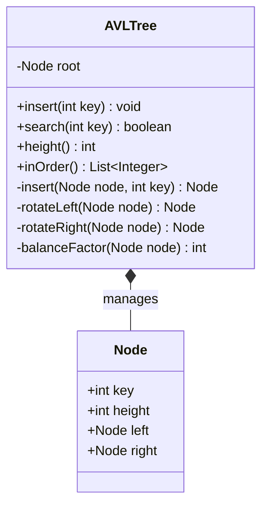

# Balanced BST Lab — AVL Tree Visualizer

A beginner-friendly project that demonstrates balanced Binary Search Trees using an interactive AVL Tree visualizer, Java implementation, and learning notes.

## What is included?

- **Interactive website:** insert, search, and delete values; visualize the tree and node balance factors.
- **AVL algorithms:** height updates and LL, RR, LR, and RL insertion rotations; deletion with rebalancing.
- **Traversal panel:** in-order, pre-order, and post-order traversal.
- **Metrics:** node count, tree height, minimum, and maximum.
- **Concept guide:** balance factors, rotation cases, and AVL vs Red-Black tree comparison.
- **Java implementation:** `java/AVLTree.java` includes AVL insertion, search, height, and in-order traversal.

## Run the website

No build tools or dependencies are needed.

1. Download and extract the repository.
2. Open `index.html` in a modern browser.
3. Select **Load sample tree** or enter integers in the control panel.

Alternatively, from this directory run:

```bash
python -m http.server 8000
```

Then visit `http://localhost:8000`.

## Run the Java implementation

Requires a JDK.

```bash
cd java
javac AVLTree.java
java AVLTree
```

Expected output includes the sorted in-order traversal, search result, and tree height.

## Key concepts

### Why balanced BSTs?

An ordinary Binary Search Tree can become skewed if values are inserted in sorted order. In that case, search, insertion, and deletion can take `O(n)`. An AVL tree updates node heights and rotates after updates to keep the tree height logarithmic.

### Balance factor

`BF(node) = height(left subtree) - height(right subtree)`

A node is AVL-balanced when its balance factor is `-1`, `0`, or `+1`.

### Rotation cases

| Case | Typical insertion order | Fix |
|---|---|---|
| LL | 30, 20, 10 | Right rotation |
| RR | 10, 20, 30 | Left rotation |
| LR | 30, 10, 20 | Left rotation on left child, then right rotation |
| RL | 10, 30, 20 | Right rotation on right child, then left rotation |

### AVL vs Red-Black tree

- **AVL:** stricter height balance; often attractive for lookup-heavy use cases.
- **Red-Black:** looser balance maintained with color rules; widely used in general-purpose ordered maps and sets.
- Both support search, insertion, and deletion in `O(log n)` worst-case time.

This project visualizes AVL operations; the Red-Black tree is covered in the learning/comparison notes, not implemented as a second live tree.

## Class diagram



## Complexity

| Operation | Time |
|---|---:|
| Search | `O(log n)` |
| Insert | `O(log n)` |
| Delete in website | `O(log n)` |
| Traversal | `O(n)` |
| Storage | `O(n)` |

## Suggested demo for your review

1. Insert `30`, `20`, `10` and explain the LL case.
2. Clear, then insert `10`, `20`, `30` and explain RR.
3. Demonstrate LR with `30`, `10`, `20`.
4. Demonstrate RL with `10`, `30`, `20`.
5. Search for an existing and a missing value.
6. Delete a node and observe the tree update.
7. Explain balance factor and compare AVL with Red-Black trees.

## Push to GitHub

Create a new, empty GitHub repository, then run these commands from the extracted folder:

```bash
git init
git add .
git commit -m "Build Balanced BST Lab AVL visualizer"
git branch -M main
git remote add origin https://github.com/YOUR-USERNAME/balanced-bst-lab.git
git push -u origin main
```

Replace `YOUR-USERNAME` with your GitHub username.
